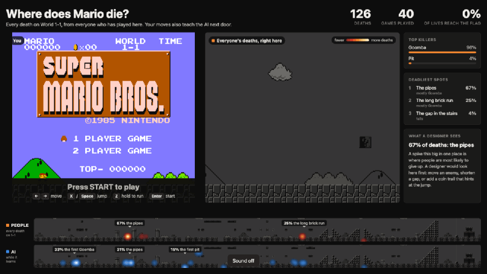

# mario-nnet-demo

Play Super Mario Bros. to help the neural net learn to beat World 11. It will learn from both your attempts and the computer’s attempts beside you.



1. **Where does Mario die?** (`deaths.html`). As players play Mario, we’ll track where they die, enhancing the heatmap to show the locations most likely to cause deaths on each level.
   
3. **An AI learning 1-1** (`ai.html`). A NEAT neural network learns the
   level by trial and error, and from the people playing screen 1. Five trials
   play at once in a 3×2 grid. The sixth cell shows Trial 1's brain live: the
   13×13 grid of blocks and enemies it sees, the neurons it has grown, and the
   buttons it presses. 

You can run this locally on almost any computer, as long as you can run a Node server. This uses the jsnes emulator vendored in `web/vendor/jsnes` (Apache-2.0).

## What you need

- Node 20 or newer, and Chrome.
- **Your own copy of the game.** The
  code expects a dump of the **Super Mario Bros. + Duck Hunt (USA)** cartridge,
  the one that came with the NES. Put the
  `.nes` file in `rom/`.

  When you launch it, the screen picks Super Mario Bros. and starts up.

## Run it

1. `node server.mjs`. The first start builds `data/maps/1-1.png` by playing
   through the level headlessly (about 10 s).
2. Open <http://localhost:8737/>. It checks the setup and links both screens.

For an event on a Mac, double-click **`start-kiosk.command`**. It starts the
server and opens each screen full-screen in its own Chrome kiosk window, with
autoplay allowed so the game has sound without a click. The AI window opens at
x=1920, on a second monitor to the right of a 1080p main display. Set `AI_X`
(and `AI_Y`) if yours is arranged differently. Quit a kiosk window with
Cmd+Q.

Both screens are laid out at 1920×1080 and scale to fit any monitor.
`node server.mjs --data <folder>` keeps a test or demo's data apart from the
event's.

## Controls

| Keyboard | Controller |
|---|---|
| ← → move, ↓ duck | d-pad or stick |
| X / Space / K jump | bottom or right face button |
| Z / J / Shift run (hold) | left or top face button |
| Enter start, Backspace select | Start / Select |

If you plug in a controller, you can also play the game with it.

### Hidden keys

| Key | Screen | Does |
|---|---|---|
| Ctrl+Alt+M | 1 | sound on/off |
| Ctrl+Alt+E | 1 | download every event as CSV |
| Ctrl+Alt+R twice | 1 | archive player deaths and recorded moves and start fresh (moved to `data/archive/`, not deleted) |
| Ctrl+Alt+T | 1 | back to the title screen |
| Ctrl+Alt+1 to 4 | 2 | on-screen speed 1×, 2×, 4×, 8× |
| Ctrl+Alt+H | 2 | background helpers on/off |
| Ctrl+Alt+N twice | 2 | Delete the  brain away and learn again from scratch|
| Ctrl+Alt+F | both | full screen |

AI screen URL options: `?speed=2`, `?workers=N` (helpers), `?pop=300`,
`?restart=10` (generations after its first clear before it starts over with a
fresh brain; `0` = never), `?stagnation=20` (see below; `0` = off),
`?extras=0` (no speed inputs), `?think=5` (frames between decisions),
`?time=0.5` (fitness lost per frame), `?giveup=40`.

## How it works

**Death detection** (`web/shared/smb.js`) reads the game's RAM every frame.
A hit by an enemy switches the engine routine (`$0E`) to 11 on the frame of
the hit. Falling down a pit pushes Mario below the screen (`$B5` ≥ 2) with the
death jingle queued. The cause is the nearest active enemy's type (`$16+`),
"Pit", or "Time" when the clock reads 000. Positions are in level pixels, so
deaths from every player line up on one map. Each death is checked against
the frame it happened on, not the life counter, which drops ~4 s later. All
addresses were verified against this cart in jsnes.

**The level map** is not a screenshot. SMB scrolls, so no single frame shows
the level. As the camera moves, the background is drawn straight from the
PPU's nametables (no sprites, no HUD) into a level-wide image. The server
builds 1-1 once by letting a star-powered bot play through with rewinds.
Other areas (bonus rooms, 1-2) are captured live as people reach them.

**The data** goes to `data/events.jsonl` (people's recorded moves go to
`data/demos.jsonl`), one JSON object per line: deaths,
flag clears, and one summary per game. Deaths more than 20 s after the last
input are kept but flagged `idle` and left out of the map, so someone walking
away does not paint the start of the level. After 60 s idle the game returns
to the title. `GET /api/export.csv` exports everything.

**The AI** (`web/shared/neat.js`, `trial.js`) is NEAT, the algorithm behind
SethBling's MarI/O. Its inputs are a 13×13 grid around Mario of solid tiles
(+1) and enemies (−1), Mario's horizontal and vertical speed, and a bias. It
has four outputs (A, B, left, right) and decides every 5 frames. Fitness is
distance reached minus half a point per frame, plus 1000 for the flag. Every
attempt starts from a savestate at the first frame of 1-1, so the same network
always plays the same run. That lets the five tiles replay each species'
champion at a watchable 2×. Meanwhile, background workers test the new
children of each generation at full speed, about 1,600 frames per second per
core. The population is saved to `data/brain/current.json` after every
generation and resumes after a restart. After the first clear, it keeps going
for 10 generations and then starts over with a fresh brain, so visitors later
in the day still see it learn. Each run's result is listed in the corner.

Why the speed inputs: with MarI/O's grid alone, the AI reached 86% of the
level by generation 30 and then stalled for 50+ generations, on two different
random seeds, dying to the same pair of Goombas between the last two pipes.
MarI/O's networks get a little accidental memory from how they are evaluated;
these are strictly feed-forward and see one still frame, so they cannot tell
whether Mario is standing or running, which decides when to jump. With
Mario's speed added as two inputs, 5 of 6 runs cleared 1-1, at generations
10, 15, 16, 20 and 22 (4 to 8 minutes of training). The sixth stalled at 94%.
`?extras=0` turns the speed inputs off to show the stall. A gentler time
penalty (⅛ point per frame instead of ½) learned more slowly, so MarI/O's
value stays.

Two safeguards for a full day:
- After 20 generations with no new record, original NEAT's stagnation rule
  lets only the two best species breed.
- After 40 generations with no new record, the screen says the brain got
  stuck and starts a fresh one (`?giveup=40`; `0` = never).

The corner of the screen shows how long it has been stuck and how earlier
runs did.

A sample of 25 AI deaths per generation goes into the same event log, marked
`source: "ai"`.

**Learning from people** (`web/shared/demos.js`, `imitate.js`). While someone
plays 1-1, every 5 frames screen 1 records what the AI would see at that
moment and which buttons the player pressed during the next 5 frames. The AI
holds each decision for 5 frames, so that is the right answer for that
moment. The last second before each death is dropped, so the AI does not copy
the move that killed them. Each life goes to `data/demos.jsonl`.

At most every 5 generations, once there are new lives (3 since the last
lesson), the AI screen fits a network that copies people. It is one logistic
regression per button. Presses and non-presses are weighted equally, separately
on the ground and in the air, and lives that got farther count more. The 40
strongest connections are kept, scaled into the range NEAT's mutations work
in. The result is exactly a NEAT network with direct links. It joins the
population with 9 mutated variants, each replacing an untested child, and the
next free tile plays its first attempt. From there NEAT treats it like any
other brain: it survives only if it plays well, and its descendants stay
marked "Taught by people". A new brain gets people's lessons at its first
chance.

What it does and doesn't do, tested with stand-in players
(`tools/bot-demos.mjs`, 40 lives, median life 21% of the level, none cleared):

- The network copied from them played 62% of 1-1 on its first try, where
  random starting brains reach 8%.
- It did not make the AI beat the level sooner. On three seeds that cleared at
  generations 16, 20 and 22 without lessons, none had cleared by generation 20
  with them (best runs 61%, 86%, 86%). The copied strategy is a strong start
  that NEAT then has to grow out of. Real players may teach better than the
  bot; that is untested.

Two fixes were needed to get here. Labelling only the exact sampled frame
missed 4 in 5 jump take-offs, so the copy never jumped. Weighting presses by
plain frequency rewarded a copy that never jumps.

## Tools

```
node tools/capture-map.mjs        rebuild data/maps/1-1.png
node tools/train.mjs              headless NEAT training on all cores, same code as the AI screen
    --gens 200 --pop 300 --seed 1 --stagnation 15 --think 5 --time 0.5 [--no-extras] --save data/brain/x.json
node tools/bot-demos.mjs          stand-in players for testing: records lives like screen 1 (--post sends them to the server; not on event day)
    --demos data/bot-demos.jsonl     (train.mjs) teach generation 0 from recorded lives
node tools/check.mjs              end-to-end test of both screens in headless Chrome (server must be running)
```

`check.mjs` plays a real game and records real events. Run it against a server
started with `--data` pointing at a scratch folder, or archive the events
afterwards with `curl -X POST 'localhost:8737/api/reset?source=people'`.

## Files

```
server.mjs              static files, /rom, events, brain, maps
start-kiosk.command     server + two Chrome kiosk windows
web/deaths.*            screen 1
web/ai.*, ai-worker.js  screen 2 (one emulator per worker)
web/shared/smb.js       SMB RAM map, boot, death watcher, level capture, AI view
web/shared/neat.js      NEAT
web/shared/trial.js     one AI attempt + fitness
web/shared/heat.js      density grid, colour ramps, heat rendering
web/shared/insights.js  1-1 zone names, summaries, designer notes
web/shared/demos.js     recording people's moves; decoding them for training
web/shared/imitate.js   fitting the copy-people network; turning it into NEAT links
web/imitate-worker.js   runs that fit off the main thread
web/vendor/jsnes        emulator (jsnes 2.1.0, Apache-2.0)
tools/                  map capture, headless training, end-to-end check, PNG encoder
rom/                    the ROM goes here (git-ignored)
data/                   everything the screens record (git-ignored)
docs/demo.gif           the clip above
```

## Credits

- [jsnes](https://github.com/bfirsh/jsnes) by Ben Firshman and contributors,
  vendored unchanged except for dropping its browser UI (Apache-2.0, license in
  `web/vendor/jsnes/LICENSE`).
- NEAT: Kenneth O. Stanley and Risto Miikkulainen, *Evolving Neural Networks
  through Augmenting Topologies*, Evolutionary Computation 10(2), 2002.
- SethBling's MarI/O, whose inputs, constants and fitness this AI starts from.

Super Mario Bros. and Duck Hunt are trademarks of Nintendo. This project is not
affiliated with or endorsed by Nintendo. It contains no Nintendo code and no
ROM; the clip above shows the game running in the emulator.
